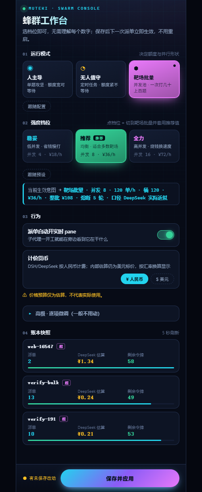

# muteki-workbench（Muteki 工作台）

右侧栏**档位式**工作台，参照 helmd 工作台的形态做的**独立小包**：不动已验证的 orchestrator 挂载，
只加一层「运行时覆盖 + UI」。战术控制台视觉（深墨蓝 + 电青/酸绿/琥珀/品红），选中态实心强调色、未选中暗底。

## 能力

- **入口两处**：会话头部「Muteki 蜂群」标签旁的「工作台」胶囊按钮（`conversation.session.header.actions`
  slot，独立 id、不 shadow 官方预设标签，非 muteki 会话不渲染），点击即展开右侧栏并切到工作台页签；
  或直接在右侧栏页签列表里开「Muteki 工作台」。
- **档位按钮，不拉滑杆**：强度用「稳妥 / 推荐 / 全力」三个按钮一键套用推荐值；
  **点档位即自动切到靶场批量**并写入 `mode=bulk` + `tier`（safe/rec/full → lite/standard/max），
  不会留下「选了档位却仍跑 attended」的错位。模式（人主导/无人值守/靶场批量）为卡片按钮，
  切离 bulk 自动清 tier；首开默认人主导 + 跟随预设（推荐仅 badge 标示）。
  非批量却带数字覆盖时显示琥珀提示（并发池不启用、数字仅作额度覆盖）。
  每个按钮带摘要与**白字悬浮提示**；逐项数字微调、成本口径、汇率收在「高级」折叠里，一般不用动。
- **计价货币切换（默认人民币）**：DSH/DeepSeek 按 CNY 计费，UI 默认 ¥ 显示；一键切 $ 美元。
  推荐档位按 **DeepSeek 实际口径**（costBasis=actual）标定，量级真实（¥18/36/72 每小时档）；
  账本显示 DeepSeek 估算（usdActual）。计价货币旁常驻免责提示：**价格预算仅为估算，不代表实际使用。**
- **其它模型**：Claude CLI 等按 estimate-anthropic 口径、DSH 子代理按墙钟估算，不做逐模型定价；
  高级里可切成本口径（estimate/actual）。
- **差异化保存按钮**：渐变胶囊「保存并应用」，有改动才亮、成功闪绿「✓ 已应用」、无改动禁用；
  旁显「● 有未保存改动 / ○ 已同步」。
- **保存即生效，不用重启 DSH**：覆盖写进 `storageDir/settings.json`，orchestrator 在下一次额度判定读取
  （优先级高于 patch config；删文件=收回覆盖）。
- **派单自动打开子代理实时对话 pane**（可关，默认开，最多 8 个）。
- **账本快照**：按题卡片显示派单次数 / DeepSeek 估算成本（¥/$）/ 剩余令牌 + 令牌条，5 秒轮询。

## 结构

| 文件 | 作用 |
|---|---|
| `server.mjs` | `ctx.inject(["webServer"])` 等服务就绪后 `webServer.register` 挂 `/api/muteki/settings`（GET/POST，白名单过滤）与 `/api/muteki/ledger`。**不能直读 `ctx.webServer`**：cordis 服务未 inject 时拿不到，会静默丢路由（实机 404 的根因） |
| `client.js` | 浏览器半：`sidebarRightTabs.register` + `sidebar.right.pane.tab` slot 注册页签；自动开 pane 监听 |
| `cordis.patch.yml` | 包自带 bundle patch：自挂服务端插件（`enabled` 可关） |
| `package.json` | `dsh.bundle.patch` + `dsh.client`（platform web，inject sidebar-right / subagent UI） |

storageDir 解析顺序：插件 config.storageDir → `~/.dsh-muteki/config.json` 的 `storage_dir` → 默认 artifacts 目录。
headless（无 webServer）时服务端静默不注册，不影响做题。

## 安装

`install.ps1` 会自动四步：包复制到 `<profile>/muteki-workbench-pkg/`、junction 到
`node_modules/muteki-workbench`、profile `package.json` 声明 `file:./muteki-workbench-pkg` 依赖、
**把 `muteki-workbench` 加进 `dsh.profile.bundles` 白名单**。重启 DSH 后右侧栏出现页签。

**白名单是关键**：DSH 的 bundle 不按 dependencies 自动发现，只按 `dsh.profile.bundles`
有序列表加载（见 dsh-app-boot 的 profile 组合逻辑）。只加依赖不进名单 = 服务端插件不挂载、
设置路由 404、客户端页签不出现。helmd 之所以有工作台，正是因为它在名单里。

手动装：同上四步，或把本目录作为 file: 依赖加入 profile package.json 并进 bundles 名单后 `pnpm install`。

## 边界

- 覆盖层只认白名单键（与 orchestrator `SETTINGS_KEYS` 一致），未知键丢弃；坏 JSON body 返回 400。
- 自动开 pane 依赖宿主 `subagentCatalog` projection 与 `subagentchat` resource provider
  （`dsh-client-ui-subagent`）；宿主缺该包时只损失自动开 pane，工作台其余功能不受影响。
- 服务端路由仅本机 web 平面可达（与 helmd 同契约），不对外监听。